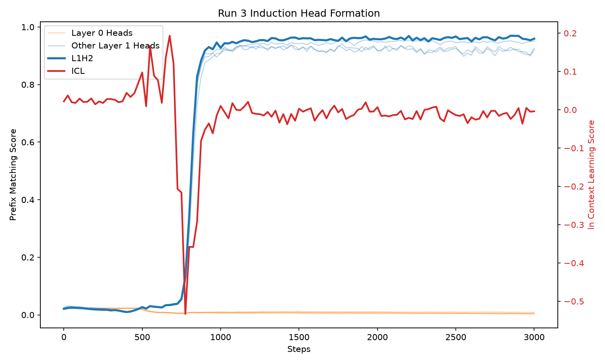
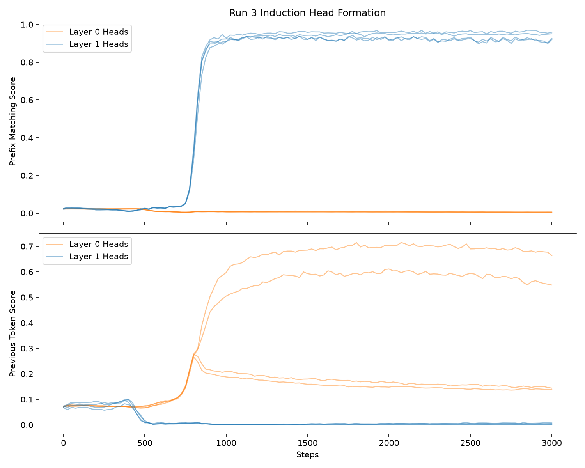

# Induction heads replication
## The figure
**Target:** reproduce the induction-head phase change from Olsson et al. (2022),
"In-context Learning and Induction Heads", at the smallest scale that shows it.

**Model:** 2-layer attention-only transformer (TransformerLens,
`attn_only=True`), d_model 128, 4 heads/layer, no MLPs, learned positional embeddings.

**Data:** sequences built as [BOS] + L random + same L with L~Uniform(20, 50), BOS-padded to 101. Earlier design was sequences of length 100 built as [BOS] + 50 random tokens + the same 50 tokens repeated but this led to a positional shortcut (see runs 1 and 2).

**Training:** AdamW, 3k steps, batch 64, checkpoint every 25 steps.

**Metrics (per checkpoint, fixed eval batch of 256 sequences):**
1. *Prefix-matching score* per head: mean attention from token t (second half) to the token following its earlier copy for j = 1..19 (positions all sequences share; j=0 excluded). Plot the best head across layers. (Prefix-matching score is Olsson et al.'s term; ARENA calls this the induction score).
2. *In-context learning score* per checkpoint: mean loss at late positions of the second copy (j = 15..19) minus mean loss at early positions (j = 1..5), where j indexes tokens of the second copy and L varies per sequence. Negative values mean the model predicts better with more context; Olsson et al. report this drops sharply at the same step the induction head forms.
3. *Previous token score* per head: mean attention from position q to position q−1, for q = 2..40 (padding-free for every sequence, since L ≥ 20). The `prev_token_head` detector in TransformerLens/ARENA. Near 1 for a previous-token head; near 0 otherwise.

**Plot:** 
`run3_plot.png`: x = training step; y = best-head prefix-matching score (left axis) and ICL score (right axis). Success = a sharp sigmoid in (1), with (2) dropping at the same step.

`run3_heads.png`: two panels: x = training step; y = prefix matching score (upper panel) and preivous token score (lower panel). Plots all 8 heads, colour-coded by layer.

**Extension (not yet run):** behavioural eval — does a copying-accuracy test on held-out sequences detect the capability at the same step as the mechanistic score, or lag it?

## Run 1 — fixed-offset data (shortcut found)

Data: [BOS] + 50 random + same 50, repeat always at offset 50.
Loss: plateau 6.92 (ln 1000) → drop at steps 225–275 → 3.46 (half of
positions predictable). Prefix-matching score of best head: 0.03 (step 200),
0.11 (225), 0.81 (250), 0.99 (275+).

Problem: the best head is L0H1 — layer 0. A layer-0 head cannot compose
with a previous-token head, so this is not an induction head. Because the
repeat offset is always 50, "attend to position t−49" is a purely positional
rule learnable from positional embeddings alone. It gives the same loss and
the same prefix-matching score as real induction, with none of the mechanism.

Lesson: a behavioural metric matched the target capability while the mechanism was absent. Run 2 breaks the regularity.

## Run 2 — variable prefix, fixed repeat distance (shortcut survived)

Data: [BOS] + 0–19 random prefix tokens + L=50 random + same 50, padded with
BOS to length 121. Loss: early plateau 6.32 (BOS padding is predictable),
drop at steps 450–500 (vs 225–275 in Run 1), floor ~3.5–3.6.
Prefix-matching score of best head: 0.05 (400), 0.12 (425), 0.49 (450),
0.90 (475), 0.99 (525+).

Problem: best head is still L0H2 — layer 0. Varying the prefix moved where
the repeat starts but not the distance between a token and its copy, which
is always 50. "Attend to position t−49" is therefore still a purely
positional rule, learnable without composition.

Lesson: the second data change I made was also insufficient; the metric
again reported a clean induction head where none could exist. Run 3 varies
the copy length so the required offset is not constant.

## Run 3 — variable copy length (induction head found)

Data: [BOS] + L random + same L, L uniform in 20..50, BOS-padded to 101.
Loss: plateau ~4.8 (padding predictable), drop at 775–900, floor ~2.45
(≈ 0.35 × ln 1000: only the first copy is unpredictable).
Best head L1H2: 0.05 (750), 0.13 (775), 0.35 (800), 0.63 (825), 0.83 (850),
0.92 (900), ~0.96 thereafter. Layer 1, as composition requires.
Transition step across runs: 250 → 475 → ~825 as each positional shortcut
was removed. (all four L1 heads converge; see Which heads)

### ICL score
ICL score: ~0 before step 700, −0.21 (725), −0.53 (775), −0.36 (800–825), −0.29 (850), −0.08 (875), back to ~0 by step 1000 and remains flat for the rest of the run.

Co-occurrence: starts slightly before the rise in prefix-matching score (725 vs 750/775) but both peak in the same 775–850 window.

Returning to zero: ICL score returns to zero after induction heads form because every second-copy token is predictable from j=1 and so loss for earlier and later tokens become similar and hence their difference approaches 0. 

Lesson: The score being zero before and after the spike are for very different reasons. In the first case the model is equally 'bad' at predicting the tokens and in the second the model is equally 'good' at predicting the tokens but our metric treats the cases as the same. So, our chosen metric is able to detect the transition, not the capability. On natural text later positions keep gaining from more context, so the late–early gap persists; here one prior occurrence is all the useful context there is, so the gap closes as soon as the head works.

### Which heads
Numbers: at step 3000 L1H0–H3 are 0.93 / 0.95 / 0.96 / 0.92; by 1000 all four are >0.9. L1H2 "wins" but only 0.03, which is within noise.

Explanation: the model has no MLPs and the first copy of the data is unpredictable so induction is likely the only useful computation which is why every layer 1 head forms an induction head. In Olsson's original paper natural-text models were used and so heads had to compete for different jobs, which explains the difference between my results and Olsson's.

Figure: `results/run3_plot.png` plots the layer-1 mean with individual heads faint. The earlier L1H2-highlighted version is in history (`17406f0`). `results/run3_heads.png` plots two panels, the upper shows layer-0 and layer-1 prefix-matching scores by step while the lower shows layer-0 and layer-1 previous-token score by step.

Layer 0 prefix-matching score: all four heads stay ~0.02 throughout which is expected as they cannot be induction heads (a layer 0 head has no access to the previous token). 

Layer 0 previous-token score: at step 3000 numbers are prev_L0H0 0.66, prev_L0H2 0.55, prev_L0H1 0.14, prev_L0H3 0.14. Timing aligns with the L1 prefix-matching rise; prev_L0H0 0.12 (750) → 0.28 (800) → 0.39 (850) → 0.50 (900) → ~0.66 (1200+) while L1H2 0.05 at 750 → 0.83 at 850.

Padding correction: over positions 2–100 the score plateaued at ~0.32; over 2–40 (padding-free for every sequence, since L ≥ 20) it's ~0.66.

L0H1/H3: rose to ~0.28 at 775, then settled at ~0.14 suggesting they didn't take the previous-token role. What they attend to instead is unchecked.

Layer 1 previous token score: prev_L1* ~0.06–0.09 early, falling to ~0.02 by 500 and <0.01 after the transition.

Conclusion: two layer-0 heads (H0, H2) become previous-token heads, rising in step with all four layer-1 induction heads. This is consistent with a two-layer composition circuit (Olsson et al.) but this is not yet verified causally.

## Reproduce

Tested on macOS (Intel), Python 3.11, torch 2.2.2 (last Intel-Mac build —
hence the NumPy 1.x pins in `requirements.txt`).

    conda create -n induction python=3.11 && conda activate induction
    pip install -r requirements.txt
    python -u train.py | tee results/run3_loss.txt
    python -u score.py | tee results/run3_scores_log.txt
    python plot.py    
    python plot_heads.py  

Runs 1–2 data files are `results/run{1,2}_prefix_scores.json` (prefix-matching only); Run 3 is `results/run3_scores.json` (prefix-matching, ICL, and previous-token), written directly by `score.py`.

Seeds are fixed (train 0, eval 1). On the same machine results match to ~4 decimal places (MPS is not bit-exact); the transition step may vary slightly across hardware.