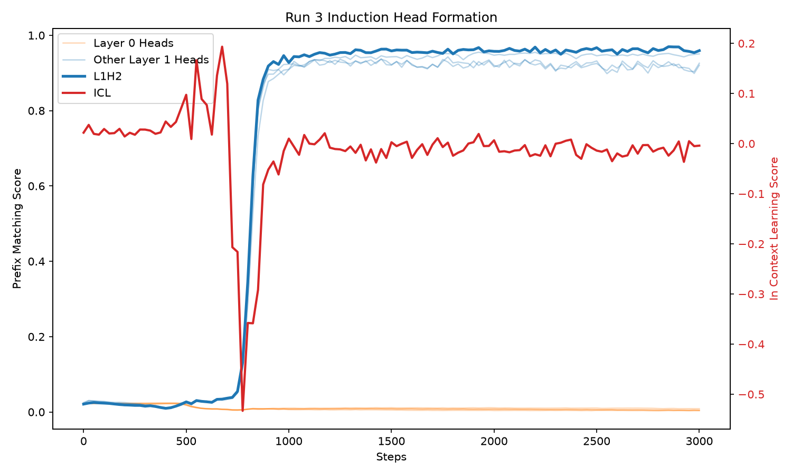
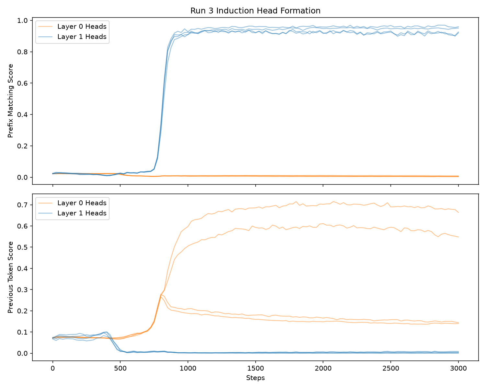
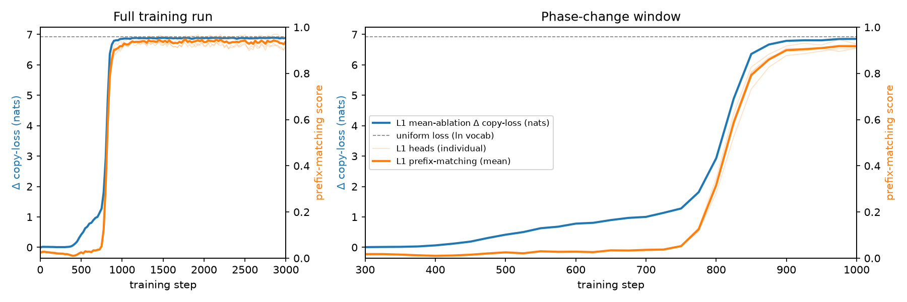
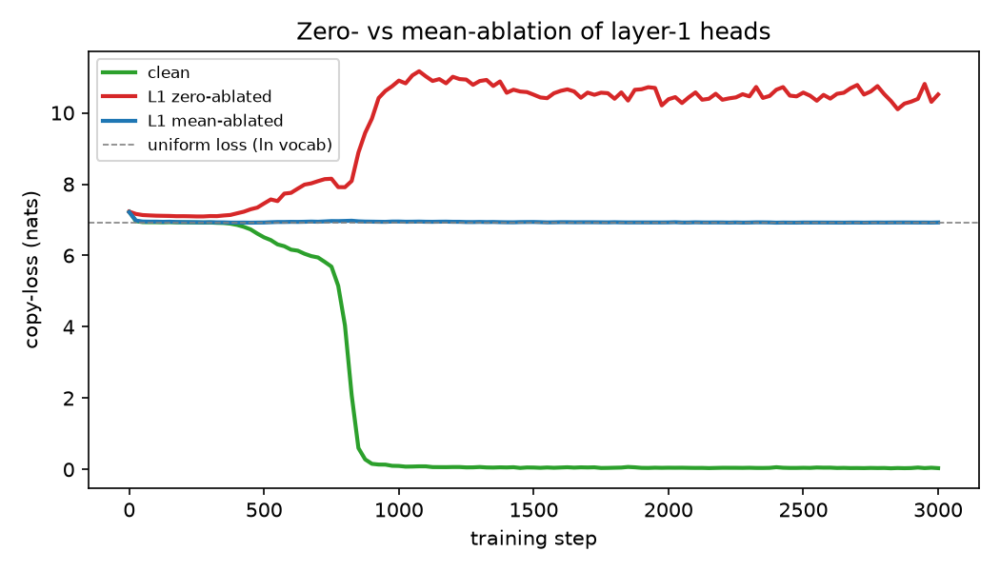

# Induction heads replication

[Extension write-up (PDF)](writeup.pdf)

## The figure
**Target:** reproduce the induction-head phase change from Olsson et al. (2022),
"In-context Learning and Induction Heads", at the smallest scale that shows it.

**Model:** 2-layer attention-only transformer (TransformerLens,
`attn_only=True`), d_model 128, 4 heads/layer, no MLPs, learned positional embeddings.

**Data:** sequences built as [BOS] + L random + same L with L~Uniform(20, 50), BOS-padded to 101. Earlier design was sequences of length 100 built as [BOS] + 50 random tokens + the same 50 tokens repeated but this led to a positional shortcut (see runs 1 and 2).

**Training:** AdamW, 3k steps, batch 64, checkpoint every 25 steps.

**Metrics (per checkpoint, fixed eval batch of 256 sequences):**
1. *Prefix-matching score* per head: mean attention from token t (second half) to the token following its earlier copy for j = 1..19 (positions all sequences share; j=0 excluded). Plot the layer-1 mean (individual heads faint). (Prefix-matching score is Olsson et al.'s term; ARENA calls this the induction score).
2. *In-context learning score* per checkpoint: mean loss at late positions of the second copy (j = 15..19) minus mean loss at early positions (j = 1..5), where j indexes tokens of the second copy and L varies per sequence. Negative values mean the model predicts better with more context; Olsson et al. report this drops sharply at the same step the induction head forms.
3. *Previous token score* per head: mean attention from position q to position q−1, for q = 2..40 (padding-free for every sequence, since L ≥ 20). The `prev_token_head` detector in TransformerLens/ARENA. Near 1 for a previous-token head; near 0 otherwise.

**Plot:** 
`run3_plot.png`: x = training step; y = layer-1 mean prefix-matching score (individual heads faint) (left axis) and ICL score (right axis). Success = a sharp sigmoid in (1), with (2) dropping at the same step.

`run3_heads.png`: two panels: x = training step; y = prefix matching score (upper panel) and previous token score (lower panel). Plots all 8 heads, colour-coded by layer.

**Extension:** per-checkpoint mean-ablation of layer-1 heads; does causal contribution track the attention signature? See below.

## Run 1 — fixed-offset data (shortcut found)

Data: [BOS] + 50 random + same 50, repeat always at offset 50.
Loss: plateau 6.92 (ln 1000) → drop at steps 225–275 → 3.46 (half of
positions predictable). Prefix-matching score of best head: 0.03 (step 200),
0.11 (225), 0.81 (250), 0.99 (275+).

Problem: the best head is L0H1 — layer 0. A layer-0 head cannot compose
with a previous-token head, so this is not an induction head. Because the
repeat offset is always 50, "attend to position t−49" is a purely positional
rule learnable from positional embeddings alone. It gives the same loss and
the same prefix-matching score as real induction, with none of the mechanism.

Lesson: a behavioural metric matched the target capability while the mechanism was absent. Run 2 breaks the regularity.

## Run 2 — variable prefix, fixed repeat distance (shortcut survived)

Data: [BOS] + 0–19 random prefix tokens + L=50 random + same 50, padded with
BOS to length 121. Loss: early plateau 6.32 (BOS padding is predictable),
drop at steps 450–500 (vs 225–275 in Run 1), floor ~3.5–3.6.
Prefix-matching score of best head: 0.05 (400), 0.12 (425), 0.49 (450),
0.90 (475), 0.99 (525+).

Problem: best head is still L0H2 — layer 0. Varying the prefix moved where
the repeat starts but not the distance between a token and its copy, which
is always 50. "Attend to position t−49" is therefore still a purely
positional rule, learnable without composition.

Lesson: the second data change I made was also insufficient; the metric
again reported a clean induction head where none could exist. Run 3 varies
the copy length so the required offset is not constant.

## Run 3 — variable copy length (induction head found)

Data: [BOS] + L random + same L, L uniform in 20..50, BOS-padded to 101.
Loss: plateau ~4.8 (padding predictable), drop at 775–900, floor ~2.45
(≈ 0.35 × ln 1000: only the first copy is unpredictable).
Best head L1H2: 0.05 (750), 0.13 (775), 0.35 (800), 0.63 (825), 0.83 (850),
0.92 (900), ~0.96 thereafter. Layer 1, as composition requires.
Transition step across runs: moves from approximately 250 → 475 → ~825 across the three runs, consistent with the progressive removal of positional shortcuts.

### ICL score
ICL score: small and positive (0.01–0.19) before step 700, −0.21 (725), −0.53 (775), −0.36 (800–825), −0.29 (850), −0.08 (875), back to ~0 by step 1000 and remains flat for the rest of the run.

Co-occurrence: starts slightly before the rise in prefix-matching score (725 vs 750/775) but both peak in the same 775–850 window.

Returning to zero: ICL returns towards zero after induction heads form because the model can use the first occurrence to predict the second. Unlike natural-text models, where additional context can continue improving predictions, the repeated-sequence task provides a single previous occurrence containing all the relevant information. Consequently, early and late second-copy positions become similarly predictable, and their loss difference approaches zero.

Lesson: The score being zero before and after the spike are for very different reasons. In the first case the model is equally 'bad' at predicting the tokens and in the second the model is equally 'good' at predicting the tokens but our metric treats the cases as the same. So, our chosen metric is able to detect the transition, not the capability. On natural text later positions keep gaining from more context, so the late–early gap persists; here one prior occurrence is all the useful context there is, so the gap closes as soon as the head works.

Plot shows Prefix-Matching Score (y left) and In-Context Learning Score (y right) against step number (x). ICL score falls (i.e. the model gets better at using context) from 0.12 at step 700 to −0.53 at step 775; over the same window the layer-1 mean prefix-matching score rises from 0.036 at step 700 to 0.79 at step 850 and plateaus at ~0.94 by step 3000.

### Which heads
Numbers: at step 3000 L1H0–H3 are 0.93 / 0.95 / 0.96 / 0.92; by 1000 all four are >0.9. L1H2 is highest, but by only ~0.01–0.04 at the final checkpoint.

Explanation: The model has no MLPs, and the first occurrence of each sequence is unpredictable. Induction is therefore a particularly useful computation for exploiting the repeated structure. The fact that all four L1 heads develop strong induction-like attention signatures may reflect the limited range of useful computations available in this simplified task. In Olsson et al.'s natural-text models, heads must support a wider variety of computations. This may help explain why induction-head-like behaviour is distributed differently in the present model.

Figure: `results/run3_plot.png` plots the layer-1 mean with individual heads faint. The earlier L1H2-highlighted version is in history (`17406f0`). `results/run3_heads.png` plots two panels, the upper shows layer-0 and layer-1 prefix-matching scores by step while the lower shows layer-0 and layer-1 previous-token score by step.

Layer-0 prefix-matching scores: all four heads remain below 0.025 and settle around 0.003–0.011 after step 575. This is expected because a layer-0 head cannot implement the standard two-layer induction mechanism: it has no access to representations contextualised by an earlier attention layer. It can, however, attend directly to the previous token, as the separate previous-token measurements demonstrate.

Layer 0 previous-token score: at step 3000 numbers are prev_L0H0 0.66, prev_L0H2 0.55, prev_L0H1 0.14, prev_L0H3 0.14. Timing aligns with the L1 prefix-matching rise; prev_L0H0 0.15 (750) → 0.28 (800) → 0.39 (850) → 0.50 (900) → 0.66 (1200), peaking at 0.71 (~1800) and settling at 0.66 (3000) while L1H2 0.05 at 750 → 0.83 at 850.

Padding correction: over positions 2–100 the score plateaued at ~0.32; over 2–40 (padding-free for every sequence, since L ≥ 20) it's ~0.66.

L0H1/H3: rose to 0.28/0.27 at step 800, then settled at ~0.14 suggesting they didn't take the previous-token role. What they attend to instead is unchecked.

Layer 1 previous token score: prev_L1* ~0.06–0.09 early, falling to <0.02 by step 500 and <0.01 after the transition.

Conclusion: two layer-0 heads (H0, H2) develop previous-token-like attention (0.66, 0.55 by step 3000), rising in step with all four layer-1 developing strong induction-like attention signatures (the group ablation shows they are collectively necessary for copying but individual contributions are untested). This is consistent with a two-layer composition circuit (Olsson et al.) but this is not yet verified causally.

Plot shows Prefix-Matching Score (y upper) and Previous Token Score (y lower) against step number (x). There is a clear shift in prefix-matching Score for Layer 1 heads with scores rising from ~0.036 at step 700 to ~0.79 at step 850, Layer 0 heads never exceed 0.025 and sit at ~0.003–0.011 after step 575. All four layer-0 previous-token scores rise together from ~0.10 at step 700 to ~0.27 at step 800; from step 825 they diverge, L0H0 and L0H2 continuing to 0.66 and 0.55 at step 3000 while L0H1 and L0H3 fall back to 0.14 (from 0.072 and 0.074 at step 0).

## Extension: does causal contribution track the attention signature?

**Question.** The replication shows layer-1 prefix-matching rising sharply while the ICL score falls over the same transition (~step 725–850). That is co-occurrence. Here I ask whether the heads' *causal* contribution to copying appears at the same step as their attention signature, before it, or after it.

**Method.** At every saved checkpoint (every 25 steps, 0–3000) I mean-ablate all four layer-1 heads (replace `hook_z` with its batch/position mean) and measure copy-loss (mean NLL over second-copy positions 1–19 on the fixed eval batch from `score.py`). Δ denotes the layer-1 mean-ablation copy-loss delta: copy-loss with the four L1 heads mean-ablated minus clean copy-loss. Zero-ablation and a layer-0 control were also run (`ablate.py`, `results/run3_ablation.json`). Following Singh et al. (2024), all four heads are ablated together, and the per-checkpoint Δ is treated as a progress measure (Nanda et al., 2023), not as a causal account of training dynamics.

**Pre-registered prediction.** Δ would lag prefix-matching by ~25–50 steps (heads present before load-bearing).

**Result.** Using 0.05 as a descriptive threshold for both measures, Δ first exceeds the threshold at step 400, approximately 350 steps before mean prefix-matching does so at step 750. The pre-registered prediction was not supported: the sharp rise in Δ and mean prefix-matching coincides over steps 775–850 (Δ: ~1.81 → ~6.36 nats; prefix-matching: ~0.125 → ~0.793), but there is no detectable lag at 25-step resolution and a smaller contribution is already apparent several hundred steps earlier. The data therefore suggest that L1 contributes to copying before developing a strong induction-like attention signature, although they do not establish the mechanism responsible for this early contribution.

1. **Layer 1 is necessary for the model's measurable copying ability.** Mean-ablating L1 returns copy-loss to approximately 6.92–6.98 nats from step 25 onwards, close to the uniform-loss baseline of 6.93 nats.
2. **Pattern and function arrive together.** Over 775–850, mean prefix-matching: 0.125 → 0.793; Δ: 1.81 → 6.36 nats during the sharp transition.
3. **A small contribution precedes the signature.** Steps ~400–700: clean copy-loss 6.86 → 5.95, while prefix-matching ≈ 0.03. L1 mean-ablation removes the model's early copying advantage over uniform prediction. However, the L0 mean-ablation control also disrupts performance, producing above-uniform loss. Thus, the data establish an early causal contribution from L1 but do not establish that this contribution exclusively accounts for the improvement.

**Method note.** Zero-ablation pushes copy-loss above uniform (8–11 nats), i.e. it confounds removal of the heads' contribution with off-distribution disruption. Mean-ablation is therefore the primary measure and is shown in the main figure; the zero-versus-mean comparison is below. The layer-0 mean-ablation control is also above uniform and is not a clean control.

Appendix figure: zero- vs mean-ablation of layer-1 heads

**Limitations.** Single run (run 3); 25-step checkpoint resolution; correlational about dynamics (Singh et al. 2024, App. D.2).

## Reproduce

Tested on macOS (Intel), Python 3.11, torch 2.2.2 (last Intel-Mac build —
hence the NumPy 1.x pins in `requirements.txt`).

    conda create -n induction python=3.11 && conda activate induction
    pip install -r requirements.txt
    python -u train.py | tee results/run3_loss.txt
    python -u score.py | tee results/run3_scores_log.txt
    python plot.py    
    python plot_heads.py
    python ablate.py
    python plot_ablation.py
    python plot_zero_vs_mean.py  

Runs 1–2 data files are `results/run{1,2}_prefix_scores.json` (prefix-matching only); Run 3 is `results/run3_scores.json` (prefix-matching, ICL, and previous-token), written directly by `score.py`. Extension results are in `results/run3_ablation.json` (clean, zero- and mean-ablated copy-loss and ICL score for layer-1 and layer-0 heads, per checkpoint), written by `ablate.py`; `plot_ablation.py` and `plot_zero_vs_mean.py` read it to produce `results/ablation_timing.png` and `results/ablation_zero_vs_mean.png`.

Seeds are fixed (train 0, eval 1). On the same machine results match to ~4 decimal places (MPS is not bit-exact); the transition step may vary slightly across hardware.